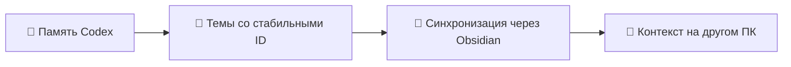

<div align="center">

# 🧌 VaultGoblin

**Гоблин, который таскает полезные знания между твоими ПК.**

Русский | [English](README_en.md)

[](https://github.com/WhyFaust/VaultGoblin/actions/workflows/tests.yml)

[](LICENSE)


</div>

Общие знания Codex между компьютерами и связанная Wiki в Obsidian. VaultGoblin
экспортирует локальную память небольшими темами со стабильными ID, помогает
вспомнить решения с другого устройства и превращает выбранные документы в заметки.

Работает с вашим vault и его настроенной синхронизацией. Поиск выполняется локально,
без сервера, эмбеддингов и вызовов модели. Компиляция Wiki запускается отдельно
через авторизованный CLI модели.



## 🚀 Быстрый старт

Нужны Python 3.10+ с SQLite FTS5 и уже синхронизируемый Obsidian vault:

```bash
git clone https://github.com/WhyFaust/VaultGoblin.git
cd VaultGoblin
python3 skills/codex-shared-knowledge/scripts/shared_knowledge.py install \
  --vault "/путь/к/Obsidian Vault" --device main-pc
python3 skills/codex-shared-knowledge/scripts/shared_knowledge.py export
```

На Windows используйте `python` вместо `python3`. На другом ПК укажите местный путь
к тому же vault и другое имя устройства. При обновлении сохраняйте прежнее имя
из `~/.codex/shared-knowledge.json`.

После установки откройте новый чат Codex. Например:

```text
Вспомни, что мы решили о миграции SQLite в проекте my-project.
Сверь найденное с текущим кодом и предложи следующий шаг.
```

Установщик добавляет навык и небольшой блок условного поиска в `AGENTS.md`.
Исходная память Codex остаётся локальной; если она ещё не создана, можно читать
знания другого устройства. [Установка, автоэкспорт и второй ПК](docs/usage.md).

## ✨ Что можно поручить

| Задача | Что делает VaultGoblin |
|---|---|
| Вспомнить решение с другого ПК | Ищет только в общем слое Codex, возвращает короткие фрагменты с источниками |
| Сохранить историю проекта | Экспортирует темы со стабильными ID и ссылками; исчезнувшие темы помечает архивными |
| Собрать Wiki | Принимает выбранные источники и объединяет их с существующими страницами |
| Разобрать документ или NotebookLM | Создаёт атомарные заметки, карту содержания и связи |
| Найти заметку в vault | Использует отдельный локальный полнотекстовый индекс после явной настройки |

Общий поиск Codex не обходит личные заметки вне `Codex Knowledge/devices`.
Широкий поиск по vault и обработка документов относятся к отдельному пайплайну
и запускаются по задаче. Исторические сведения нужно сверять с текущими источниками.

## 🗂️ Устройство проекта

| Путь | Содержимое |
|---|---|
| [skills/codex-shared-knowledge/](skills/codex-shared-knowledge/SKILL.md) | Устанавливаемый навык, экспорт и ограниченный поиск общих знаний |
| [pipeline/](pipeline/AGENTS.md) | Импорт, Wiki, правила, промпты, шаблоны и тесты |
| [docs/usage.md](docs/usage.md) | Установка, обновление и перенос между устройствами |
| [docs/shared-knowledge.md](docs/shared-knowledge.md) | Формат тем, поиск, архив и восстановление |
| [docs/pipeline.md](docs/pipeline.md) | Документы, NotebookLM, Wiki и обслуживание vault |
| [docs/automation.md](docs/automation.md) | Хуки и резервный автоэкспорт |
| [docs/comparison.md](docs/comparison.md) | Сравнение с близкими инструментами |
| [docs/audit.md](docs/audit.md) | Независимый аудит и исправления |
| [docs/development.md](docs/development.md) | Проверки, структура и локальные данные |

Git-клон — источник кода. Путь к нему сохраняется как `repository_path` в местных
настройках; установленный навык — рабочая копия. Авторизация, пути, заметки,
экспорты и SQLite-базы в Git не входят.

## 🧪 Проверка

```bash
python3 -m unittest discover -s skills/codex-shared-knowledge/tests -q
```

Проверки импорта и Wiki требуют отдельного окружения; команды для Linux и Windows
приведены в [руководстве разработчика](docs/development.md). CI проверяет оба
компонента на Linux и Windows без реальных заметок и вызовов модели.

## 📜 Лицензия

[MIT](LICENSE). Уведомления об авторстве сохранены в лицензии.
