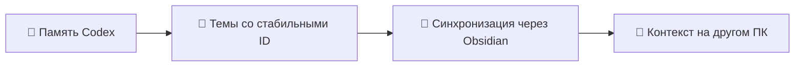

<div align="center">

# 🧌 VaultGoblin

**Гоблин, который таскает полезные знания между твоими ПК.**

Русский | [English](README_en.md)

[](https://github.com/WhyFaust/VaultGoblin/actions/workflows/tests.yml)

[](LICENSE)


</div>

Общие знания Codex между компьютерами и связанная Wiki в Obsidian. VaultGoblin
экспортирует локальную память небольшими темами со стабильными ID, помогает
вспомнить решения с другого устройства и превращает выбранные документы в заметки.

Работает с вашим vault и его настроенной синхронизацией. Поиск выполняется локально,
без сервера, эмбеддингов и вызовов модели. Компиляция Wiki запускается отдельно
через авторизованный CLI модели.



## 🚀 Быстрый старт

Нужны Codex с поддержкой плагинов, Python 3.10+ с SQLite FTS5 и уже
синхронизируемый Obsidian vault. На Windows `python` и `pythonw.exe` должны быть
доступны в `PATH`.

```bash
codex plugin marketplace add WhyFaust/VaultGoblin
codex plugin add vaultgoblin@vaultgoblin
```

Откройте **Setup** у установленного плагина или явно вызовите в чате:

```text
Используй $vaultgoblin-setup. Vault: C:\Users\name\Documents\Obsidian Vault,
имя устройства: windows-pc.
```

Для существующей установки запустите Setup без новых параметров: местные пути,
имя устройства и дополнительные настройки сохранятся. На другом ПК укажите его
путь к тому же vault и другое имя устройства.

На Windows Setup настраивает тихий экспорт при входе и раз в 5 минут.
Новые hooks нужно проверить и разрешить в **Settings > Hooks** или `/hooks`;
установка плагина сама по себе не предоставляет им доверие. На Linux используется
событийный наблюдатель, на macOS доступен ручной экспорт.

После настройки откройте новый чат Codex. Например:

```text
Вспомни, что мы решили о миграции SQLite в проекте my-project.
Сверь найденное с текущим кодом и предложи следующий шаг.
```

Исходная память Codex остаётся локальной; если она ещё не создана, можно читать
знания другого устройства. [Установка, миграция и вариант без плагина](docs/usage.md).

## ✨ Что можно поручить

| Задача | Что делает VaultGoblin |
|---|---|
| Вспомнить решение с другого ПК | Ищет только в общем слое Codex, возвращает короткие фрагменты с источниками |
| Сохранить историю проекта | Экспортирует темы со стабильными ID и ссылками; исчезнувшие темы помечает архивными |
| Собрать Wiki | Принимает выбранные источники и объединяет их с существующими страницами |
| Разобрать документ или NotebookLM | Создаёт атомарные заметки, карту содержания и связи |
| Найти заметку в vault | Использует отдельный локальный полнотекстовый индекс после явной настройки |

Общий поиск Codex не обходит личные заметки вне `Codex Knowledge/devices`.
Широкий поиск по vault и обработка документов относятся к отдельному пайплайну
и запускаются по задаче. Исторические сведения нужно сверять с текущими источниками.

## 🗂️ Устройство проекта

Внутри `Codex Knowledge` команда `organize --apply --clean-setup` создаёт
`README.md` и страницы `Projects/` с названиями тем, разделением актуального
и архивного контекста. Служебные `devices/` остаются совместимыми со вторым ПК;
старые установочные копии из `Setup` сохраняются в локальном backup и убираются
из vault. Подробнее — [автоматизация и навигация](docs/automation.md).

| Путь | Содержимое |
|---|---|
| [skills/codex-shared-knowledge/](skills/codex-shared-knowledge/SKILL.md) | Устанавливаемый навык, экспорт и ограниченный поиск общих знаний |
| [pipeline/](pipeline/AGENTS.md) | Импорт, Wiki, правила, промпты, шаблоны и тесты |
| [docs/usage.md](docs/usage.md) | Установка, обновление и перенос между устройствами |
| [docs/shared-knowledge.md](docs/shared-knowledge.md) | Формат тем, поиск, архив и восстановление |
| [docs/pipeline.md](docs/pipeline.md) | Документы, NotebookLM, Wiki и обслуживание vault |
| [docs/automation.md](docs/automation.md) | Хуки и резервный автоэкспорт |
| [docs/comparison.md](docs/comparison.md) | Сравнение с близкими инструментами |
| [docs/audit.md](docs/audit.md) | Независимый аудит и исправления |
| [docs/development.md](docs/development.md) | Проверки, структура и локальные данные |

Исходники меняют в Git-клоне. При работе через плагин код берётся из его активной
установки; прежний `repository_path` не переключает выполнение на старый клон.
Настройки, индекс и журнал остаются в `CODEX_HOME`, отдельно от кэша плагина.
Авторизация, пути, заметки, экспорты и SQLite-базы в Git не входят.

## 🧪 Проверка

```bash
python3 -m unittest discover -s skills/codex-shared-knowledge/tests -q
```

Проверки импорта и Wiki требуют отдельного окружения; команды для Linux и Windows
приведены в [руководстве разработчика](docs/development.md). CI проверяет оба
компонента на Linux и Windows без реальных заметок и вызовов модели.

## 📜 Лицензия

[MIT](LICENSE). Уведомления об авторстве сохранены в лицензии.
