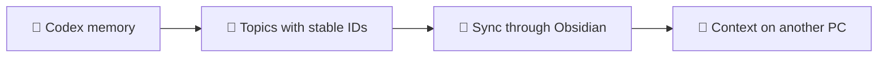

<div align="center">

# 🧌 VaultGoblin

**A small goblin carrying useful knowledge between your computers.**

[Русский](README.md) | English

[](https://github.com/WhyFaust/VaultGoblin/actions/workflows/tests.yml)

[](LICENSE)


</div>

Shared Codex knowledge across computers and a linked Wiki in Obsidian. VaultGoblin
exports local memories as topics with stable IDs, recalls decisions from another
device and turns selected documents into connected notes.

It uses your vault and its existing synchronization. Search runs locally, without
a server, embeddings or model calls. Wiki compilation is a separate operation
using an authenticated model CLI.



## 🚀 Quick start

You need Python 3.10+ with SQLite FTS5 and an Obsidian vault already set up to sync:

```bash
git clone https://github.com/WhyFaust/VaultGoblin.git
cd VaultGoblin
python3 skills/codex-shared-knowledge/scripts/shared_knowledge.py install \
  --vault "/path/to/Obsidian Vault" --device main-pc
python3 skills/codex-shared-knowledge/scripts/shared_knowledge.py export
```

On Windows, use `python` instead of `python3`. On another computer, use its local
path to the same vault and a different device name. When updating, keep the name
from that computer's `~/.codex/shared-knowledge.json`.

After installation, open a new Codex chat. For example:

```text
Recall what we decided about the SQLite migration in my-project.
Check the findings against the current code and suggest the next step.
```

The installer adds the skill and a small conditional recall block to `AGENTS.md`.
Native Codex memory stays local. If it has not been generated yet, you can still
read another device's knowledge. See [setup, scheduling and a second PC](docs/usage_en.md).

## ✨ What to ask for

| Task | What VaultGoblin does |
|---|---|
| Recall a decision from another PC | Searches only the shared Codex layer and returns short passages with sources |
| Preserve project history | Exports linked topics with stable IDs; marks retired topics as archived |
| Build a Wiki | Takes selected inputs and merges them into existing pages |
| Process a document or NotebookLM notebook | Creates atomic notes, a map of content and links |
| Find a vault note | Uses a separate local full-text index after explicit setup |

Shared Codex search does not scan personal notes outside `Codex Knowledge/devices`.
Vault-wide search and document processing belong to a separate pipeline and run
when requested. Historical findings must be checked against current sources.

## 🗂️ Project layout

| Path | Contents |
|---|---|
| [skills/codex-shared-knowledge/](skills/codex-shared-knowledge/SKILL.md) | Installable skill, export and bounded shared-knowledge search |
| [pipeline/](pipeline/AGENTS.md) | Import, Wiki, rules, prompts, templates and tests |
| [docs/usage_en.md](docs/usage_en.md) | Setup, updates and use across devices |
| [docs/shared-knowledge_en.md](docs/shared-knowledge_en.md) | Topic format, search, archives and recovery |
| [docs/pipeline_en.md](docs/pipeline_en.md) | Documents, NotebookLM, Wiki and vault maintenance |
| [docs/automation_en.md](docs/automation_en.md) | Hooks and fallback exports |
| [docs/comparison_en.md](docs/comparison_en.md) | Comparison with related tools |
| [docs/audit_en.md](docs/audit_en.md) | Independent audit and fixes |
| [docs/development_en.md](docs/development_en.md) | Checks, layout and local data |

The Git clone is the source of code. Local settings record it as `repository_path`;
the installed skill is a deployed copy. Authentication, local paths, notes,
exports and SQLite databases do not belong in Git.

## 🧪 Checks

```bash
python3 -m unittest discover -s skills/codex-shared-knowledge/tests -q
```

Import and Wiki checks need a separate environment; see the Linux and Windows
commands in the [development guide](docs/development_en.md). CI tests both
components on Linux and Windows without real notes or model calls.

## 📜 License

[MIT](LICENSE). Copyright notices are preserved in the license.
